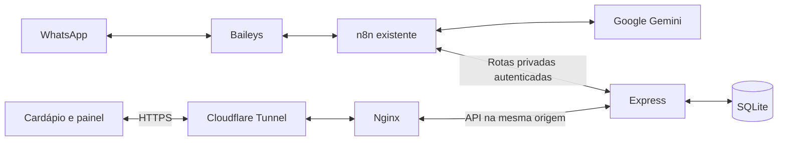

# GaletoBot

GaletoBot é um projeto independente do Galeto Master, desenvolvido para o desafio KODIE de Inteligência Artificial e Automação. A FAQ original evoluiu para um assistente de pedidos de restaurante pelo WhatsApp. O cliente consulta o cardápio, monta o pedido e recebe a confirmação pelo celular. A equipe acompanha pedidos e estoque no painel.

## Problema e solução

Responder perguntas de preço, disponibilidade e entrega manualmente toma tempo e pode gerar pedidos inconsistentes com o estoque. O GaletoBot interpreta a conversa, consulta dados vigentes e exige confirmação explícita. A API mantém preços, frete e baixa de estoque no backend.

- **Cliente:** cardápio público, consulta de estoque, carrinho, entrega por região, seleção de pagamento e resumo.
- **Operação:** painel autenticado, pedidos, produtos, estoque baixo, configurações e histórico de movimentações.
- **WhatsApp:** Baileys recebe e envia mensagens. O n8n coordena o fluxo e aciona o Gemini quando a API pede interpretação.

## Arquitetura e atendimento



O frontend React é compilado pelo Vite. Na hospedagem, Nginx serve o build e encaminha as rotas do navegador ao Express. O SQLite persiste catálogo, estoque, configurações, clientes, pedidos e carrinhos. A confirmação registra o pedido e atualiza estoque na mesma transação.

O Baileys envia ao webhook a mensagem original e seus identificadores. A API de contexto informa catálogo e dados faltantes. O prompt do Gemini pede ações JSON estruturadas e inclui exemplos de múltiplos itens, entrega, Pix e respostas curtas. O JavaScript do n8n normaliza os campos. A API valida as ações, consulta preços e frete do cadastro e devolve o campo `resposta`. Com um resumo vigente, o cliente pode confirmar com `1` ou com frases como “Pode confirmar”. O comando legado com UUID continua aceito.

| Interface | Contrato |
| --- | --- |
| Baileys → n8n | `POST` no webhook com `X-GaletoBot-Token` |
| n8n → API | `POST /api/integrations/conversation/context` e `POST /api/integrations/conversation` com `x-integration-token` |
| Navegador → API | Sessão administrativa em cookie HttpOnly, SameSite e Secure na hospedagem. Escritas administrativas verificam a origem. |

O workflow publicado tem sufixos nos nomes dos nós e alterações manuais no prompt. Sua cópia sanitizada depende do export real. [Export de referência](docs/n8n/galetobot-kodie-gemini-ia.json) · [Roteiro do workflow publicado](docs/kodie/roteiro-n8n.md)

## Estrutura

O chat público e o Laboratório IA são opcionais e não dependem do Baileys. Consulte o [guia de atendimento multicanal](docs/atendimento-web.md) para configurar a demonstração isolada, homologar a integração e preparar o rollback.

O perfil WhatsApp oferece vinculação, diagnóstico e controle da automação em **Configurações → Conexão WhatsApp**. Consulte o [guia da Central WhatsApp](docs/whatsapp-central.md) para preparar a instalação e proteger a sessão.

O [guia do design system Brasa](docs/design-system-brasa.md) descreve o piloto de Visão Geral e Pedidos, os indicadores financeiros e a estratégia de reuso nas demais telas.

| Caminho | Conteúdo |
| --- | --- |
| `apps/api/` | Node.js, Express, SQLite, Baileys, regras comerciais e testes |
| `apps/web/` | Cardápio e painel React/Vite |
| `deploy/`, `scripts/deploy/` | Proxy, inicialização isolada e snapshots |
| `docs/n8n/` | Export de referência e contrato |
| `docs/kodie/`, `docs/evidencias/` | Entrega e índice de evidências |

## Instalação local

Use Node.js 24 ou ambiente compatível com o lockfile. Na raiz, no PowerShell:

```powershell
npm.cmd ci
if (!(Test-Path .env.development)) { Copy-Item .env.example .env.development }
```

Edite `.env.development` com administrador de teste, senha de pelo menos 12 caracteres e token próprio. Defina `DATABASE_ALLOW_CREATE=1` só para criar uma base descartável e retire a opção depois. O padrão é `apps/api/data/demo/galeto-demo.db`. `DEMO_DATABASE_PATH` permite escolher outro arquivo dentro do diretório de demonstração. Para uso no computador, configure `HOST=127.0.0.1` e `APP_ORIGIN=http://localhost:5173`.

```powershell
npm.cmd run dev
npm.cmd test -w apps/api
npm.cmd run build
git diff --check
```

Os testes usam SQLite temporário. Para abrir o painel no celular em rede privada, ajuste `GALETO_WEB_HOST=0.0.0.0` e use a origem LAN do painel em `APP_ORIGIN`.

## Hospedagem

A proposta usa Debian 13 num LXC dedicado, Docker Compose, Express e o build React servido pelo Nginx. O Cloudflare Tunnel publica uma única origem HTTPS. O n8n atual acessa as rotas privadas por uma porta LAN com origem restrita. O adaptador WhatsApp fica em perfil optativo. A API hospedada exige banco existente e mantém o catálogo e o checkout ativos.

| Variáveis | Finalidade |
| --- | --- |
| `APP_ORIGIN` | Origem HTTPS exata |
| `ADMIN_EMAIL`, `ADMIN_PASSWORD` | Administrador de bootstrap. Contas existentes conservam a senha. |
| `WEBHOOK_TOKEN` | Autenticação do n8n na API |
| `LAN_BIND_IP`, `N8N_SOURCE_IP` | IP do LXC e origem permitida do n8n |
| `DATABASE_DIR`, `DATABASE_FILENAME` | Diretório persistente e arquivo existente |
| `RELEASE`, `PUBLIC_LOOPBACK_PORT`, `INTEGRATION_PORT` | Tag das imagens e portas |
| `N8N_WEBHOOK_URL`, `N8N_WEBHOOK_TOKEN`, `WHATSAPP_SESSION_DIR` | Destino, credencial e sessão do perfil WhatsApp |

O Compose fornece `NODE_ENV=production`, `HOST=0.0.0.0`, `PORT=3000` e `DATABASE_PATH` à API. A chave Gemini permanece na credencial do n8n. Use `.env.production.example` como modelo. Depois de preencher o ambiente e provisionar o banco:

```bash
docker compose --env-file .env.production config --quiet
docker compose --env-file .env.production build api web
docker compose --env-file .env.production up -d --wait api web
```

O domínio `galetobot.santirine.com.br` é o destino pretendido e ainda será configurado. [Guia Proxmox, Docker, HTTPS, migração e rollback](docs/deploy/proxmox.md)

## Pedido real de teste

Na validação relatada pela equipe, o pedido **#1** entrou pelo WhatsApp e apareceu como **Pendente** no painel. O pagamento escolhido foi Pix, sem transação financeira.

| Item | Valor | Estoque antes → depois |
| --- | ---: | --- |
| 2 galetos com farofa | R$ 110,00 | 10 → 8 |
| 3 porções de arroz | R$ 24,00 | 8 → 5 |
| 1 salpicão | R$ 25,00 | 2 → 1 |
| Feijão tropeiro fora do pedido | — | 5 → 5 |

Subtotal de **R$ 159,00**, frete de **R$ 2,00** para Morro do Meio, reconhecido como Presidente Médici, e total de **R$ 161,00**. A equipe registrou capturas do WhatsApp, painel, estoque, n8n e Gemini. [Entrega KODIE](docs/kodie/README.md) · [Anonimização das evidências](docs/evidencias/README.md)

## Limitações e próximos passos

- O painel tem uma única classe de administrador. Use uma instância isolada com dados fictícios para avaliadores.
- Ampliar apelidos de produtos, naturalidade das respostas e frases de cancelamento. O carrinho já aceita algumas formas de cancelamento natural.
- Corrigir a autenticação no domínio externo do n8n. A integração validada usa a rede interna.
- A equipe verifica o recebimento de Pix externamente e registra a confirmação no detalhe do pedido. O sistema não consulta bancos nem armazena comprovantes.
- Validar o deploy no LXC, configurar o domínio e publicar o workflow sanitizado após revisão.
