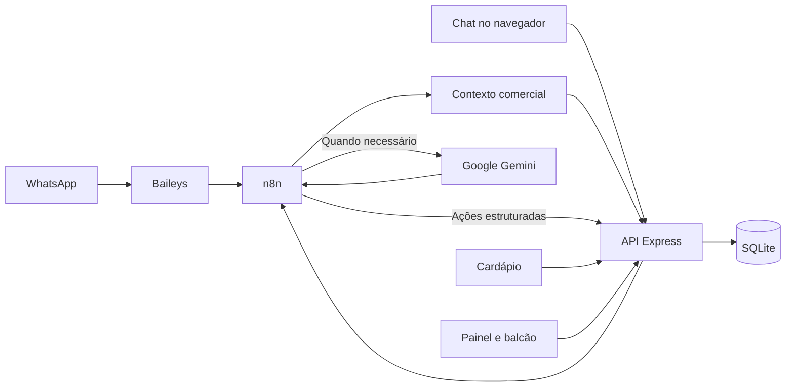

# GaletoBot 2.0

Atendimento multicanal e gestão de pedidos para estabelecimentos gastronômicos. O GaletoBot reúne conversas assistidas por inteligência artificial, cardápio digital e operação administrativa em uma aplicação independente do Galeto Master.

Desenvolvido para o desafio de Inteligência Artificial e Automação da KODIE, o projeto parte de um problema prático. Consultar disponibilidade, calcular entregas e registrar pedidos manualmente exige tempo e pode gerar divergências no estoque. O sistema conecta o atendimento aos dados comerciais e apresenta um resumo antes da confirmação.

## Demonstração

A [demonstração KODIE](https://demo-galetobot.santirine.com.br) possui banco e credenciais próprios. O [cardápio público](https://demo-galetobot.santirine.com.br/cardapio) pode ser acessado sem login. O acesso administrativo de avaliação é fornecido separadamente.

O ambiente de demonstração e a operação comercial são instalações distintas. A disponibilidade do atendimento inteligente depende da configuração e do funcionamento dos serviços de integração.

## Funcionalidades

- Atendimento pelo WhatsApp com Baileys, chat público e Laboratório IA.
- Cardápio com categorias, busca, disponibilidade, entrega ou retirada e acompanhamento do pedido.
- Painel responsivo em temas claro e escuro, pedidos em lista e Kanban e balcão com carrinho.
- Gestão de produtos, fotografias, clientes, estoque, movimentações e configurações comerciais.
- Pagamentos Pix, cartão e dinheiro, com cálculo de troco e registro financeiro independente do estado do pedido.
- Central WhatsApp com controle da automação, pareamento, diagnóstico e gerenciamento da sessão.

O carrinho do cardápio e o da conversa são independentes. O atendimento humano usa os mecanismos disponíveis de transferência e retomada e o contato configurado para o chat.

## Arquitetura



React e Vite compõem as interfaces. O Express concentra as regras comerciais e o SQLite persiste o catálogo, clientes, pedidos, pagamentos e movimentos de estoque. O Laboratório utiliza uma instalação demonstrativa isolada quando a instalação atende uma operação comercial.

## Inteligência artificial e automação

O canal envia `session_id`, `message_id` e `mensagem` ao workflow. A API fornece o contexto e sinaliza quando uma interpretação é necessária. O n8n pode consultar o Gemini e normaliza a resposta em ações estruturadas. A API valida as ações, consulta o catálogo e aplica as regras comerciais.

Na homologação informada para a mensagem “Quero arroz e galeto”, a resposta interpretada incluiu:

```json
{
  "actions": [
    { "type": "add", "value": "arroz", "quantity": 1 },
    { "type": "add", "value": "galeto", "quantity": 1 }
  ]
}
```

A IA interpreta intenções. Preços, fretes, disponibilidade, confirmação de pagamento e execução do pedido permanecem sob controle da API.

## Regras comerciais e segurança

A confirmação exige um resumo vigente. A API valida os dados e registra o pedido e a baixa de estoque em transação SQLite. Identificadores e chaves de idempotência protegem reenvios e confirmações duplicadas. A confirmação do pedido e o recebimento do pagamento são estados independentes.

O painel usa autenticação por sessão, cookies protegidos e validação de origem nas escritas. Integrações têm credenciais separadas e limites de requisições. Imagens enviadas por administradores são verificadas, redimensionadas e armazenadas fora do banco. A instalação exige proteção da rede, segredos próprios e isolamento entre ambientes. Consulte a [documentação de hospedagem](docs/hospedagem.md).

## Tecnologias

Node.js, Express, React, Vite, SQLite, Docker Compose, n8n, Google Gemini e Baileys. O design system Brasa utiliza Manrope, Inter e ícones Lucide.

## Capturas e evidências

O [índice de evidências](docs/evidencias/README.md) identifica os registros disponíveis e as pendências de revisão para publicação. Capturas com dados de execução ou identificadores devem passar por sanitização antes de serem divulgadas.

## Estrutura

| Caminho | Conteúdo |
| --- | --- |
| `apps/api/` | API comercial, persistência, integração e testes |
| `apps/web/` | Painel, cardápio e chat em React |
| `deploy/` | Configuração do proxy |
| `scripts/deploy/` | Inicialização e utilitários operacionais |
| `docs/n8n/` | Workflow de referência e instruções |
| `docs/kodie/` e `docs/evidencias/` | Roteiro e evidências da entrega |

## Instalação local

Use Node.js 24 e um banco de demonstração independente. No PowerShell, na raiz do repositório:

```powershell
npm.cmd ci
Copy-Item .env.example .env.development
```

Configure `.env.development` com credenciais de teste próprias, `HOST=127.0.0.1` e `APP_ORIGIN=http://localhost:5173`. Use `DATABASE_ALLOW_CREATE=1` somente para inicializar uma base descartável. O padrão de demonstração é `apps/api/data/demo/galeto-demo.db`.

```powershell
npm.cmd run dev
npm.cmd test -w apps/api
npm.cmd run build
```

O perfil de chat depende da configuração específica de n8n. Consulte [atendimento multicanal](docs/atendimento-web.md) e [Central WhatsApp](docs/whatsapp-central.md).

## Configuração do n8n

O [export KODIE 2.0](docs/n8n/galetobot-kodie-demo-2.0.json) é uma referência sanitizada para importação em um ambiente próprio. Configure as URLs de contexto e conversa, credenciais de integração e Gemini, webhook e variáveis correspondentes antes de ativá-lo. Não inclua segredos no export. O [roteiro n8n](docs/kodie/roteiro-n8n.md) descreve o contrato e os cuidados operacionais.

## Testes e homologação

A suíte automatizada executada nesta preparação passou com 59 testes, usando bancos temporários. O build do frontend também passou. Os testes com mocks não substituem a homologação dos serviços externos.

Conforme as evidências fornecidas pelo responsável, a homologação do Chat Web 2.0 usou o Laboratório, n8n, Gemini 3.5 Flash Lite e API. O pedido de demonstração #1 registrou arroz e galeto, subtotal de R$ 53,00, frete de R$ 10,00 e total de R$ 63,00. O pagamento em dinheiro ficou a receber. Galeto passou de 10 para 9 unidades e arroz de 8 para 7. Não houve transação financeira real.

Há homologação anterior de pedidos de teste pelo WhatsApp, registrada no projeto. Essa validação ocorreu em outra etapa e não comprova a estabilidade prolongada da sessão atual.

## Hospedagem, limitações e próximos passos

A implantação prevista utiliza Docker Compose, proxy Nginx, SQLite persistente e acesso HTTPS. Cada instalação deve ter banco, sessões e segredos próprios. As fotografias precisam ser incluídas no backup junto ao banco. O [guia de hospedagem](docs/hospedagem.md) reúne referências de instalação e rollback.

A estabilidade prolongada do WhatsApp, a proteção da demonstração pública e a recuperação em ambiente real exigem acompanhamento. O fluxo de IA depende da disponibilidade e configuração dos serviços externos. Antes de ampliar o acesso, revise as evidências, o histórico Git e as configurações de segurança de cada ambiente.

## Autoria

Projeto desenvolvido por SantirineTech para o desafio KODIE.
